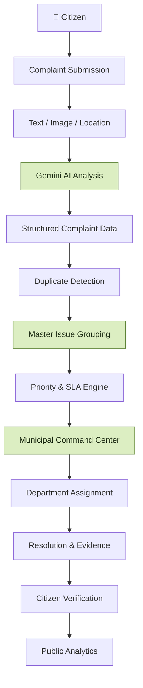
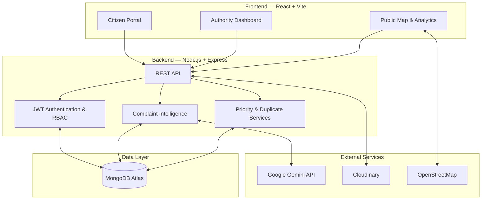

# 🏙️ NagarMitra
### From Citizen Complaints to Intelligent Civic Action.

<p align="center">
  <strong>An AI-powered civic intelligence platform transforming scattered citizen complaints into actionable urban insights.</strong>
</p>

<p align="center">
  
  
  
  
  
</p>

<p align="center">
  <a href="https://frontend-chi-eight-ahfchil2eh.vercel.app/">🌐 Live Demo</a> •
  <a href="#-features">✨ Features</a> •
  <a href="#-architecture">🏗️ Architecture</a>
</p>

---


## 💡 The Problem

Cities receive thousands of civic complaints about potholes, damaged roads, blocked drains, overflowing garbage and public safety hazards.

However, traditional complaint systems often treat every report as an isolated issue, making it difficult to identify recurring problems, understand their collective impact and prioritize interventions.

## 🚀 Our Solution

**NagarMitra goes beyond complaint collection.**

It combines multimodal AI, duplicate detection, geospatial intelligence and municipal workflows to transform individual citizen reports into actionable civic intelligence.

Our goal is to help authorities move from reactive complaint management to smarter, more proactive civic governance.

---

## ✨ Features

<table>
<tr>
<td width="50%" valign="top">

### 📝 Multimodal Citizen Reporting
Report civic issues through text, images and voice, with GPS, address search and interactive map-based location selection.

</td>
<td width="50%" valign="top">

### 🧠 AI-Powered Complaint Intelligence
Gemini analyzes complaint descriptions and images to identify issue categories, assess potential risks and recommend departments.

</td>
</tr>
<tr>
<td width="50%" valign="top">

### 🔗 Intelligent Duplicate Detection
Connect related complaints under shared Master Issues to identify recurring infrastructure problems and collective citizen impact.

</td>
<td width="50%" valign="top">

### 📍 Geospatial Civic Intelligence
Interactive maps visualize complaint locations and geographical patterns, helping authorities identify civic hotspots.

</td>
</tr>
<tr>
<td width="50%" valign="top">

### 🚨 Smart Prioritization & SLA Management
Prioritize issues using configured severity and impact factors while monitoring assignments and resolution deadlines.

</td>
<td width="50%" valign="top">

### 🏛️ Municipal Command Center
A dedicated authority dashboard for complaint inspection, departmental assignment, progress monitoring and resolution management.

</td>
</tr>
<tr>
<td width="50%" valign="top">

### ✅ Citizen-Powered Resolution Verification
Authorities submit resolution evidence while citizens independently verify outcomes and flag unresolved issues.

</td>
<td width="50%" valign="top">

### 📊 Public Transparency & Analytics
Explore complaint trends, resolution statistics, departmental performance and geographical distributions.

</td>
</tr>
<tr>
<td colspan="2" valign="top">

### 🤖 Conversational Civic Assistant
An AI-powered conversational interface for interacting with NagarMitra's civic reporting and information workflows. *(Document only capabilities implemented in the current version.)*

</td>
</tr>
</table>

---


## ⚙️ How It Works



### A simple example

Three citizens report potholes in the same locality.

1. AI analyzes each complaint.
2. Duplicate detection identifies potentially related reports.
3. Reports are grouped under a common Master Issue.
4. The system calculates priority using configured factors.
5. Authorities assign a team and track resolution.
6. Citizens verify the outcome.

**Multiple reports. One identified problem. One coordinated response.**

---

## 🏗️ Architecture

NagarMitra follows a decoupled full-stack architecture.



### Architecture highlights

- **Frontend:** Citizen and authority interfaces built with React.
- **Backend:** Express REST APIs with authentication and role-based access.
- **AI:** Gemini-powered complaint analysis.
- **Database:** MongoDB Atlas for persistent application data.
- **Media:** Cloudinary for image storage.
- **Maps:** Leaflet and OpenStreetMap for geographical visualization.

---

## 🛠️ Tech Stack

| Category | Technologies |
|---|---|
| Frontend | React 19, Vite, Tailwind CSS |
| Backend | Node.js, Express.js |
| Database | MongoDB Atlas, Mongoose |
| AI | Google Gemini API |
| Authentication | JWT, bcrypt |
| Media Storage | Cloudinary |
| Maps | Leaflet, OpenStreetMap |
| Charts | Recharts |
| Deployment | Vercel, Render |

---

## 🚀 Getting Started

### Prerequisites

- Node.js and npm
- MongoDB Atlas account
- Google Gemini API key
- Cloudinary account

### 1. Clone the repository

```bash
git clone YOUR_GITHUB_REPOSITORY_URL
cd NagarMitra
```

### 2. Set up the backend

```bash
cd backend
npm install
```

Create a `backend/.env` file:

```env
PORT=5000
NODE_ENV=development
CLIENT_URL=http://localhost:5173

MONGODB_URI=your_mongodb_connection_string

JWT_SECRET=your_secure_jwt_secret
JWT_EXPIRES_IN=7d

GEMINI_API_KEY=your_gemini_api_key
GEMINI_MODEL=gemini-3-flash-preview

CLOUDINARY_CLOUD_NAME=your_cloud_name
CLOUDINARY_API_KEY=your_cloudinary_api_key
CLOUDINARY_API_SECRET=your_cloudinary_api_secret
```

Start the backend:

```bash
npm run dev
```

Backend: `http://localhost:5000`

### 3. Set up the frontend

Open a new terminal:

```bash
cd frontend
npm install
```

Create a `frontend/.env` file:

```env
VITE_API_BASE_URL=http://localhost:5000/api
```

Start the frontend:

```bash
npm run dev
```

Frontend: `http://localhost:5173`

### 4. Verify

Open the frontend and check the backend health endpoint:

`http://localhost:5000/api/health`

Verify database connectivity and test the complaint submission workflow.

---

## 🔐 Environment Variables

| Variable | Purpose |
|---|---|
| `PORT` | Backend server port |
| `NODE_ENV` | Runtime environment |
| `CLIENT_URL` | Allowed frontend origin |
| `MONGODB_URI` | MongoDB connection string |
| `JWT_SECRET` | Authentication token secret |
| `JWT_EXPIRES_IN` | Token validity |
| `GEMINI_API_KEY` | Gemini API credential |
| `GEMINI_MODEL` | Gemini model identifier |
| `CLOUDINARY_CLOUD_NAME` | Cloudinary account |
| `CLOUDINARY_API_KEY` | Cloudinary API key |
| `CLOUDINARY_API_SECRET` | Cloudinary API secret |
| `VITE_API_BASE_URL` | Frontend backend API URL |


---

## 🌍 Deployment

NagarMitra uses the following deployment setup:

| Component | Platform |
|---|---|
| Frontend | Vercel |
| Backend | Render |
| Database | MongoDB Atlas |
| Image Storage | Cloudinary |

Configure production environment variables, frontend API URL and backend CORS origins before deployment.

**Live Application:** [YOUR_LIVE_DEMO_URL](YOUR_LIVE_DEMO_URL)

---

## 🧪 Testing & Reliability

Important areas for testing include:

- Authentication and role-based access.
- Complaint creation and database persistence.
- Gemini analysis and image uploads.
- Duplicate detection and Master Issue grouping.
- Authority assignment and resolution.
- Citizen verification and analytics.
- Production API connectivity and error handling.

*Only report tests as passing when they have actually been executed.*

---

## 🔮 Future Scope

- Multilingual voice-first civic reporting.
- Agentic municipal authority copilot.
- AI-assisted civic root-cause investigation.
- Predictive civic hotspot intelligence.
- Smart municipal resource allocation.

---

## 👥 Team

**Built with ❤️ for smarter, more responsive cities.**

| Contributor 
|
| Akshit Agarwal 
| Ayush Kumar


---

<p align="center">
  <h2>🏙️ NagarMitra</h2>
  <strong>From Citizen Complaints to Intelligent Civic Action.</strong>
  <br />
  <sub>A smarter way to report. A better way to respond.</sub>
</p>
